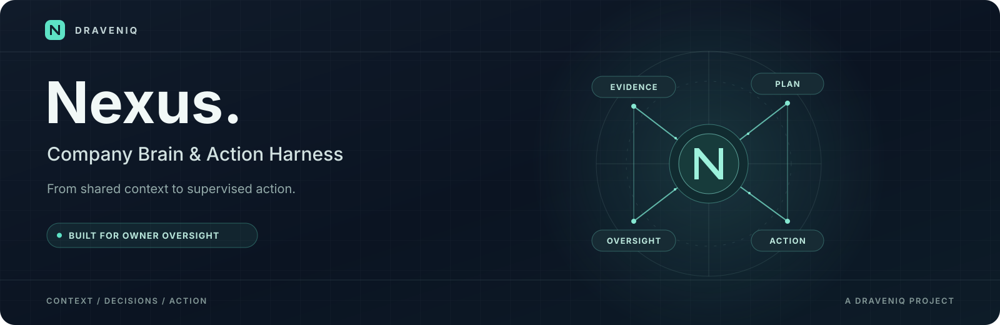
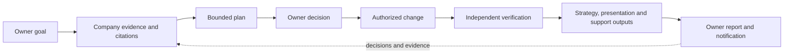

# Nexus



**DravenIQ's supervised Company Brain and Action Harness.** Nexus is being built
as an internal operating system for company knowledge, management, and governed
work. It is a development project, not a released autonomous company.

The first release keeps the owner in control: Nexus should bring evidence and
proposals to the owner, carry out only authorized work within explicit limits,
and report what happened. More delegated operation is a later owner decision,
not an automatic change of authority.

## The operating cycle

The first release target is a complete **Nexus-owned** cycle:



This diagram describes the intended end-to-end outcome. Individual steps have
implementation and test evidence, but the complete cycle has not yet passed
release acceptance. StockFlow is an optional future integration test; it is not
the release target.

## How Nexus is organized

| Part | Responsibility |
| --- | --- |
| **Company Brain** | Organize company sources, evidence, citations, relationships and access-controlled context. |
| **Management** | Connect goals, proposed plans, departmental work and owner decisions. |
| **Action Harness** | Check authority, budgets, ownership and current evidence at the point work is admitted or an effect is issued. |
| **Durable execution** | Record work, decisions, attempts and outcomes so interrupted operations can be recovered or reconciled. |
| **Builder and verifier** | Make a bounded change in isolation and obtain a separate, evidence-backed verification. |
| **Owner experience** | Present goals, approvals, work, costs, reports and notification status. |

The [company architecture](docs/company-system/ARCHITECTURE.md) explains these
boundaries and the difference between design and verified operation. An owner
approval is a decision about a specific proposal; it does not by itself prove
that a worker ran or an external effect succeeded. Unknown outcomes remain
visible for reconciliation rather than being treated as successful retries.

## Current status

As of the 29 October 2026 development checkpoint:

- A planner-to-coder-to-publication workflow passed on isolated PostgreSQL/DBOS
  using two mock SDK requests; the separate accounting audit passed. This is not
  evidence of live-provider quality or a complete owner-to-report cycle.
- The committed backend passed 5,828 unit cases without coverage. The previous
  source cohort's combined coverage was 64.54%, below the unchanged 80% gate.
  The [task board](TASKS.md) records the current source and validation status.
- Signed-in owner acceptance, a representative independently verified Nexus
  build, real provider qualification and whole-cycle reporting remain open.
- Private ARM64 operation, independent restore, rollback and a 24-hour soak remain
  release requirements. No release date is committed.

The first release is supervised. Delegated and Board modes depend on later
reviewed operating evidence and an explicit owner decision. Automatic Meta Harness
improvement is deferred.

## Repository guide

| Location | Contents |
| --- | --- |
| [Task board](TASKS.md) | Canonical delivery tasks, dependencies, evidence and blockers. |
| [Focused delivery plan](docs/company-system/NEXUS_FOCUSED_DELIVERY_PLAN_2026-10-16.md) | Nexus-only operating cycle and acceptance direction. |
| [Company architecture](docs/company-system/ARCHITECTURE.md) | System boundaries, lifecycle and deployment target. |
| [Product progress](docs/company-system/PROGRESS.md) | Dated implementation and validation history. |
| [Release evidence](docs/company-system/RELEASE_GATES_CURRENT.md) | Historical evidence index; reconcile current status with the task board. |
| [SDD v0.2](docs/sdd/NEXUS_SDD_v0.2.md) | Original company-system design; later Nexus-focused decisions supersede its first scenario. |
| [Legacy architecture](docs/ARCHITECTURE.md) | Earlier Kafka-based architecture retained for context, not the current company release claim. |
| [Decisions](docs/DECISIONS.md), [changelog](docs/CHANGELOG.md), [error log](docs/ERRORLOG.md) | Design decisions, change history and retained failures. |
| [`backend/nexus/company/`](backend/nexus/company/) | Company Brain, management, controls, strategy and notifications. |
| [`frontend/`](frontend/) | React and TypeScript owner interface. |

## Development and checks

The backend declares Python 3.12+ and pins key runtime libraries in
[`backend/pyproject.toml`](backend/pyproject.toml); the committed lock file is
[`backend/uv.lock`](backend/uv.lock). The frontend uses React, TypeScript and
Vite with its own lock file. Company and legacy Alembic migrations have separate
configuration; use the company-specific plan for a fresh company installation.

The CI definitions in [`.github/workflows/ci.yml`](.github/workflows/ci.yml)
show the actual lint, type, unit and isolated PostgreSQL integration commands.
For example, after installing the locked development dependencies, the backend
checks include:

```bash
cd backend
uv run --frozen --extra dev ruff check .
uv run --frozen --extra dev python scripts/check_legacy_ruff_baseline.py
uv run --frozen --extra dev ruff format --check nexus/ company_alembic/
uv run --frozen --extra dev mypy nexus/ --strict
uv run --frozen --extra dev pytest nexus/tests/unit/ -v --tb=short
```

The migration lint guard retains and checks a specific historical baseline; it
does not claim those historical diagnostics were fixed. The repository also
requires an unchanged 80% coverage gate before a pull request. CI's current
unit command does not itself measure coverage. Test databases must be disposable
and isolated; never point destructive fixtures at a real company database.

The company preview, provider configuration, deployment and backup procedures
have their own readiness gates. Do not infer production readiness from source
presence, a mock test or the legacy setup instructions.
