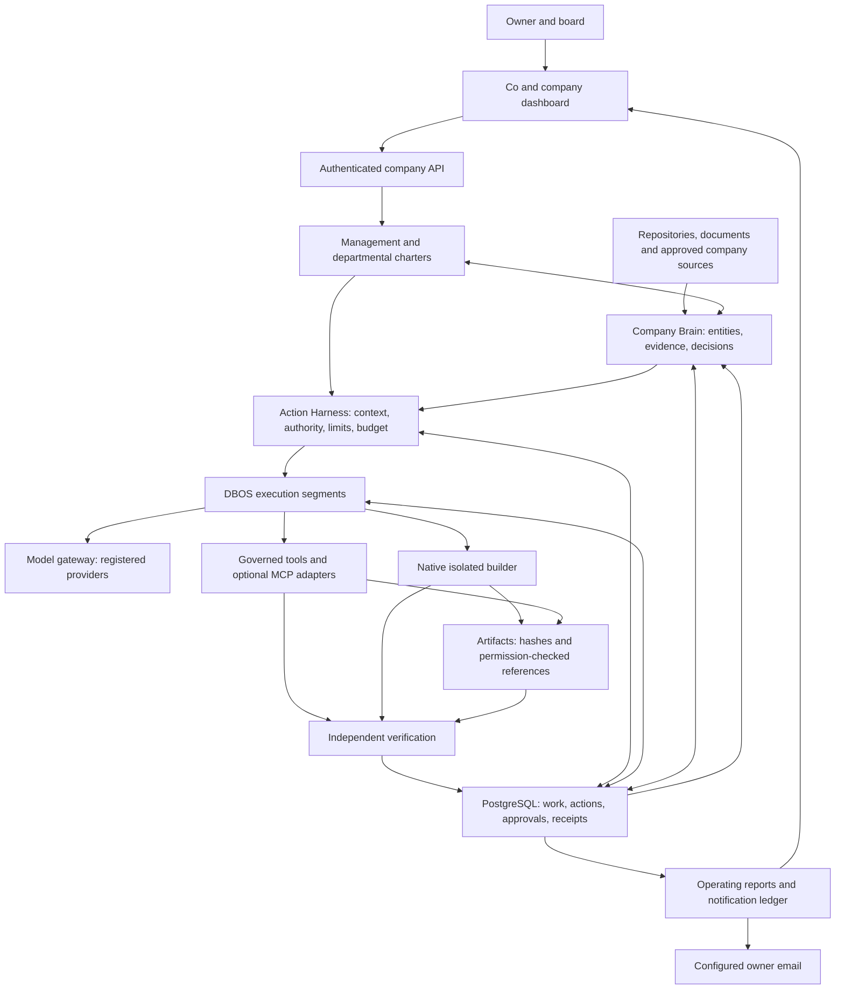
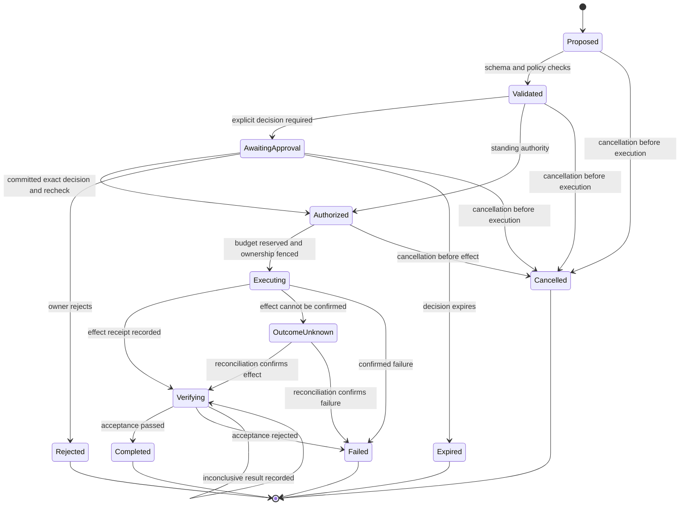
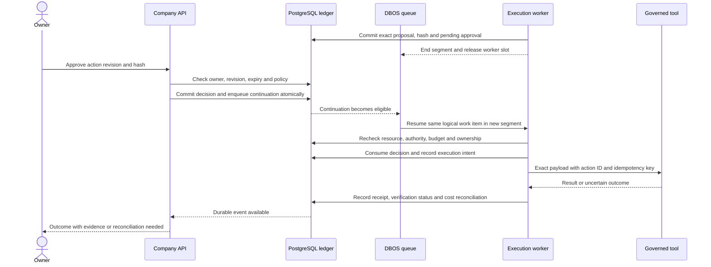
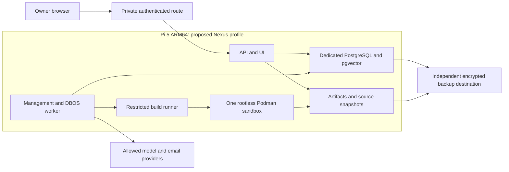

# Nexus company-system architecture

**Date:** 2026-10-05. **Status:** proposed target, documentation only.\
The [SDD](../sdd/NEXUS_SDD_v0.2.md) defines semantics; this document explains boundaries. The [implementation plan](IMPLEMENTATION_PLAN.md) owns delivery gates.

## System boundaries

All consequential operations pass the harness. PostgreSQL owns durable business state; DBOS owns checkpointed execution. Management, knowledge relationships and work dependencies have distinct contracts. The builder has no production write mount or ungoverned API path.

## Action lifecycle

`inconclusive` is a verification result: the action remains `verifying` until evidence resolves it or it is explicitly closed as failed with an inconclusive result. An unknown external effect is reconciled without blind retry. Already-issued effects cannot be undone by changing a task to cancelled.

## Approval without occupying a worker

The short-lived API transaction never waits for model execution. Approval itself does not bypass a later resource or policy conflict. The same counters and budget lineage survive both segments.

## Pi deployment profile

Podman installation and this profile are future deployment work. Model credentials stay with the gateway; database credentials stay outside builder jobs. Core processes target at most 3 GiB combined; the single builder defaults to 2 CPUs and 4 GiB with explicit disk and time limits. Existing Pi services remain separate. The inspected storage path was root-backed, so an independent backup destination still needs configuration.
