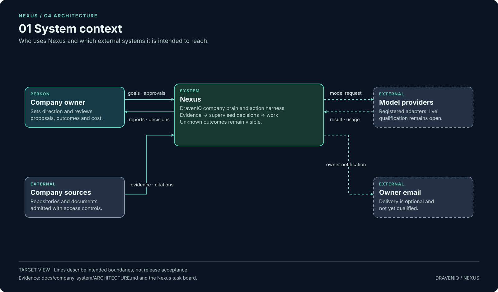
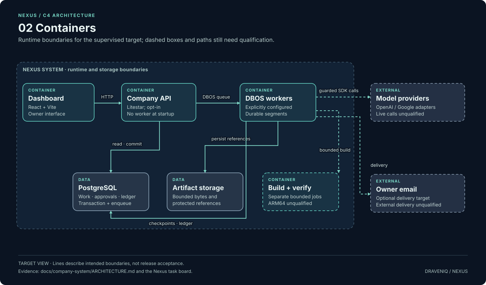
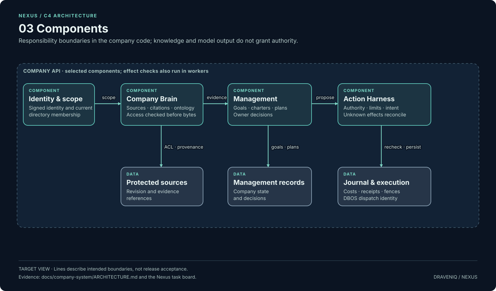
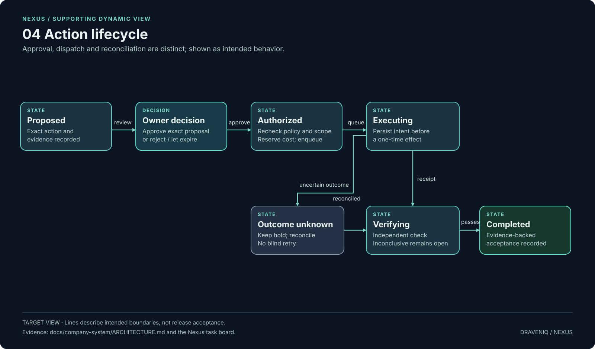

# Nexus company-system architecture

**Updated:** 2026-10-29. This document describes the selected architecture and
its intended boundaries. Diagrams are **target flows**, not evidence that every
connection has been exercised in one deployed system. The
[SDD](../sdd/NEXUS_SDD_v0.2.md) defines semantics; the owner-directed
[Nexus-focused delivery plan](NEXUS_FOCUSED_DELIVERY_PLAN_2026-10-16.md)
supersedes its earlier StockFlow-first scenario. The [task board](../../TASKS.md)
tracks current work and evidence; the [implementation plan](IMPLEMENTATION_PLAN.md)
defines the delivery gates.

Nexus is DravenIQ's internal **Company Brain and Action Harness**. The first
release is supervised: the owner sets direction, reviews proposed plans and
authorizes governed effects. The intended operating cycle uses Nexus's own
goal and evidence, proceeds through an approved plan, authorized change and
independent verification, and produces departmental outputs and an owner report.
StockFlow is an optional later integration test, not the first release target.
Delegated and Board modes require a separate owner decision after operating
evidence; automatic Meta Harness improvement is deferred.

## Current evidence and open boundaries

At the 29 October feature checkpoint, the repository contains the company Brain,
management, harness, model, planning, coding, strategy, reporting and notification
components. A fresh isolated PostgreSQL/DBOS integration exercised planning,
coding and publication with **two SDK mock requests** and a separate read-only
accounting audit. This is useful integration evidence, not proof of real provider
quality or a complete owner-operated cycle. The signed-in owner journey, live
provider qualification and usage, independent native builder/ARM64, same-goal
departmental outputs, notification delivery, deployment, restore, rollback and
24-hour soak remain release gates. Check the [task board](../../TASKS.md) for
newer results; test counts and coverage are tied to the particular source and
environment that produced them.

## The supervised operating cycle

The following is the intended first-release journey. An arrow describes a required
handoff, not a guarantee that the complete path has already passed acceptance.

The intended cycle is **owner goal → evidence and citations → proposed plan → owner decision → authorized change → independent verification → departmental outputs → owner report and notification**.

A saved goal is not an approved plan; an approved plan is not an executed action;
a candidate is not an independently verified result. Failures, blocked work and
unknown effects stay visible in the report.

## System boundaries

The container view separates the owner interface, opt-in company API, separately
configured workers and data stores. Dashed or annotated relationships show
planned or unqualified capabilities, not proof that they are deployed.

The [detailed architecture](ARCHITECTURE_C4_DETAIL.md) maps each layer to source
and explains the communication, tools, authority checks and outstanding evidence.

The intended boundary sends consequential effects through the harness rather than
letting a departmental role or knowledge object authorize itself. PostgreSQL owns
durable business state; DBOS coordinates checkpointed execution segments.
Management, knowledge relationships and work dependencies have distinct
contracts. The target builder has no production write mount or ungoverned API
path; native isolation and recovery are still qualification gates.

## Engineering methods and roles

| Method | Nexus application | Boundary |
| --- | --- | --- |
| Loop engineering | Observe evidence, propose work, authorize, execute, verify and report; blocked or unknown outcomes remain explicit. | A loop is not evidence of autonomous completion. |
| Harness engineering | Enforce current identity, policy, approval, budget, ownership and receipt checks at action boundaries. | A model response, tool adapter or knowledge citation cannot grant authority. |
| Graph engineering | Model work dependencies and the relationships between goals, evidence, decisions and artifacts. | These are distinct contracts; a dedicated graph database is deferred. |
| Ontology engineering | Use typed company concepts and evidence references with explicit revisions and provenance. | Knowledge records describe the company; they do not confer execution authority. |
| Meta Harness | Consider evidence-based changes to the operating harness in a future phase. | Automatic self-improvement is deferred and is not a release capability. |

Management, strategy, engineering, presentation and support represent different
responsibilities over shared company evidence. Their presence as concepts or
components does not prove that all roles have produced accepted outputs for the
same goal. The focused plan specifies the first integrated demonstration.

## Action lifecycle

| Stage | Meaning and possible next step |
| --- | --- |
| Proposed / validated | Bind a proposal and check schema and policy; a decision or standing authority may be required. |
| Awaiting approval | Record the exact owner decision, rejection or expiry; waiting does not occupy a worker. |
| Authorized / executing | Recheck authority and current resources; reserve the bounded effect and record intent before issuance. |
| Outcome unknown | Preserve the uncertainty and reconcile it without blind replay. |
| Verifying | Evaluate the recorded effect independently; inconclusive results remain open. |
| Completed / failed / cancelled | Record the actual terminal result. Cancellation cannot undo an already-issued external effect. |

`inconclusive` is a verification result: the action remains `verifying` until evidence resolves it or it is explicitly closed as failed with an inconclusive result. An unknown external effect is reconciled without blind retry. Already-issued effects cannot be undone by changing a task to cancelled.

## Approval without occupying a worker

1. The worker records a specific proposal and pending approval, then releases its slot.
2. The owner submits a decision. The API validates the current owner, proposal revision and expiry, then records the decision; this does not itself prove a dispatch.
3. An authorized scheduling operation rechecks the binding and atomically consumes authority, binds the source, holds cost and enqueues the continuation.
4. A separately configured DBOS worker resumes the work and rechecks authority, budget, ownership and resources at the effect boundary.
5. The worker persists the intent before issuing the permitted request, then records a receipt or an unknown outcome and reconciles cost.
6. The owner sees the recorded state and evidence; a candidate does not become verified solely because a worker returned it.

This is the target protocol; implementations may separate approval and dispatch
requests while keeping the dispatch's authority consumption, source binding,
reservation and enqueue in one transaction. A short-lived API transaction does
not wait for model execution. Approval does not bypass a later resource or policy
conflict. Parent work permanently partitions lifetime allowances; retries, new
segments and a new Bangkok day do not reset them. The selected company-day model
limit is US$5 in Asia/Bangkok. Issued calls with unknown usage keep their holds
until reconciliation. A fence protects application writes; it cannot undo or
fence an external effect that does not support fencing. Actual provider billing
and live day-boundary behavior remain to be qualified.

## Pi deployment profile

The proposed private profile places the company API, owner interface, separately
configured DBOS workers, dedicated PostgreSQL and protected artifact storage on
an ARM64 host behind an authenticated private route. A restricted builder would
run one isolated sandbox; provider and email calls would leave through their
respective governed adapters. An independent encrypted destination is needed for
backup. These are design intentions, not a verified deployment.

This is a proposed private deployment, not a claim that Nexus is deployed or
that the sandbox limits are enforced. Model credentials are intended to stay
with the gateway; database credentials stay outside builder jobs. Core processes
target at most 3 GiB combined; the single builder defaults to 2 CPUs and 4 GiB
with explicit disk and time limits. ARM64 toolchain, actual enforcement,
cancellation/recovery, independent backup and restore, rollback, and the 24-hour
soak require separate evidence. Existing Pi services remain separate. The
inspected storage path was root-backed, so an independent backup destination
still needs configuration.
